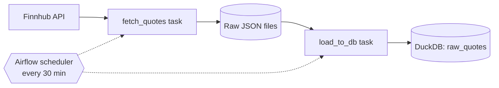

# Stock Market Data Pipeline

An automated ETL pipeline that pulls live stock quotes from the Finnhub API every 30 minutes, lands them as raw JSON, and loads them into a DuckDB warehouse. It is orchestrated with Apache Airflow, runs in Docker, and is safe to re-run without creating duplicate data.

## Architecture



## Tech stack

- **Orchestration:** Apache Airflow (via Astro CLI)
- **Storage / warehouse:** DuckDB
- **Language:** Python (`requests`, `duckdb`)
- **Infrastructure:** Docker

## How it works

1. **Extract:** Airflow triggers a Python task that calls the Finnhub `/quote` endpoint for each tracked symbol (AAPL, MSFT, GOOGL, AMZN, TSLA) and stamps each record with a `fetched_at` UTC timestamp.
2. **Land:** Each run writes one timestamped JSON file to `include/data/raw/`. Raw files are never modified, so any downstream logic can be replayed from them.
3. **Load:** A second task loads new files into the `raw_quotes` table in DuckDB.

## Design decisions

- **Idempotent loads:** a `loaded_files` table records every file already ingested, so re-running the load never duplicates rows.
- **Raw zone kept immutable:** if a transformation has a bug, data can be reprocessed from the original files.
- **Retries:** each task retries twice, one minute apart, to survive temporary API failures.
- **Secrets outside code:** the API key is read from an environment variable and `.env` is git-ignored.
- **Rate limiting:** a short delay between API calls stays within Finnhub's free-tier limits.

## Run it locally

Prerequisites: Docker, [Astro CLI](https://www.astronomer.io/docs/astro/cli/install-cli), and a free [Finnhub](https://finnhub.io) API key.

```bash
git clone https://github.com/pbakshihub/stock-pipeline.git
cd stock-pipeline
echo "FINNHUB_API_KEY=your_key_here" > .env
astro dev start
```

Open the Airflow UI (the URL is printed in the terminal), enable the `stock_pipeline` DAG, and trigger a run.

## Roadmap

- [ ] dbt models: staging layer and daily OHLC marts
- [ ] Data quality tests
- [ ] Cloud storage and warehouse
- [ ] Dashboard
- [ ] TODO: streaming or ML feature table

## What I learned
ETL pipelines, data idempotency, Airflow orchestration, DAG runs
TODO: write 2-3 sentences in your own words, for example the idempotency bug you hit and how you fixed it.
